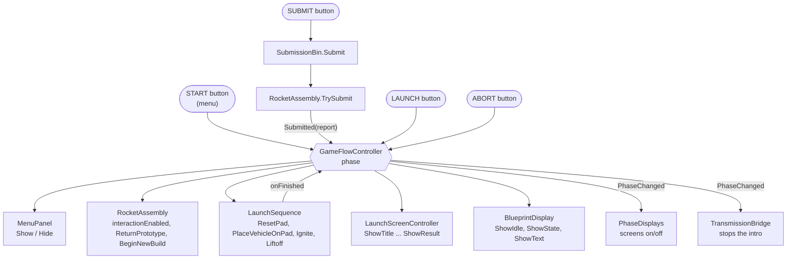
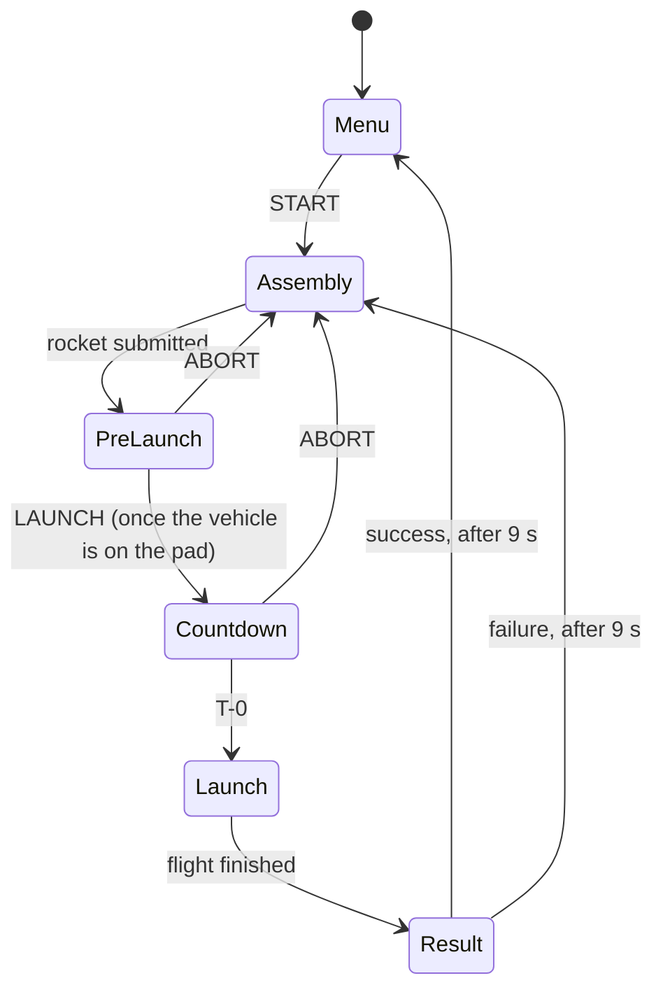

# 02 The game engine (GameFlow)

How the game moves from the start menu to building, launching and the result, which object runs it, and how to change it or plug into it. Back to the [main spec](README.md).

| | |
|---|---|
| **Where in the Editor** | `VRRocket_Main` → `GameFlow` (root object) |
| **The engine** | `GameFlowController` on `GameFlow`: `Assets/Scripts/Runtime/GameFlowController.cs` |
| **Helpers on the same object** | `LaunchScreenController`, `BlueprintDisplay`, `PhaseDisplays`, `AudioSource` |
| **Children** | `EventSystem` (XR UI input), `MenuCanvas` (the start menu) |
| **Tests** | `GameFlowTests` (3 full games in `VRRocket_Main`), `RoomIntegrationTests` (button wiring, intro), see [spec 10](10-testing-and-debugging.md) |

## 1. What the game engine is

The "game engine" is one component: **`GameFlowController`**. It is a small **state machine** with six phases:

`Menu` → `Assembly` → `PreLaunch` → `Countdown` → `Launch` → `Result` → back to `Menu` or `Assembly`

It holds a reference to every system that takes part in the game, and on each phase change it tells them what to do: lock or unlock the rocket kit, show the menu, write the screens, put the vehicle on the pad, start the flight. The systems report back through events: the rocket says it was submitted, the launch says the flight is over.

It never touches a rocket part itself. Everything about the rocket goes through `RocketAssembly` ([spec 03](03-rocket-assembly.md)), and everything about the flight through `LaunchSequence` ([spec 04](04-launch-simulator.md)).



## 2. The `GameFlow` object

Select `GameFlow` in the Hierarchy of `VRRocket_Main`. It sits at the world origin and has five components:

| Component | Job |
|---|---|
| `GameFlowController` | the game engine (this spec) |
| `AudioSource` | plays the engine's beeps and chimes: 2D, volume 0.7 |
| `LaunchScreenController` | writes the big TV, the console monitor and the corner clock ([spec 05](05-screens-and-displays.md)) |
| `BlueprintDisplay` | writes the step text on the blueprint panel above the desk ([spec 05](05-screens-and-displays.md)) |
| `PhaseDisplays` | switches our mission screens off during the menu and on for the game (section 6) |

And two children:

- `EventSystem` with `XRUIInputModule`: lets the XR controllers' rays click world-space UI ([spec 08](08-xr-rig-and-input.md)).
- `MenuCanvas`: the start menu ([spec 06](06-menu.md)).

## 3. `GameFlowController` in the Inspector

**References.** Each one points at a component on another object. If one is empty, the engine simply skips that system (it checks for null everywhere).

| Field | Points at | Used for |
|---|---|---|
| Assembly | `RocketWorkstation` (`RocketAssembly`) | locking the kit, the build state, returning the rocket, a new kit |
| Bin | `ConsoleAddOn/SubmissionBin` | the "bin opens" sound and the return spot for a failed rocket |
| Launch | `LaunchSite` (`LaunchSequence`) | the pad, the vehicle and the flight |
| Screen | `GameFlow` (`LaunchScreenController`) | everything shown on the big TV |
| Menu | `GameFlow/MenuCanvas` (`MenuPanel`) | the start menu |
| Blueprint | `GameFlow` (`BlueprintDisplay`) | the step text above the desk |
| Audio | `GameFlow` (`AudioSource`) | beeps, chimes, buzzes |

**Timing** (seconds):

| Field | Value | Meaning |
|---|---|---|
| Countdown Seconds | 10 | length of the countdown (rounded to whole seconds, at least 1) |
| Ignition At | 3 | the engine lights when the countdown reaches this number |
| Result Seconds | 9 | how long the result screen stays before the next phase |
| Submit To Pad Seconds | 2.5 | how long the rocket takes to grow on the pad; LAUNCH is refused until then |

**Text:**

| Field | Value |
|---|---|
| Assembly Hint | "Turn around: the kit is on the desk behind you. Fins at the base, flaps at the midpoint with the swept edge up, nose on top, motor nozzle down, then twist the cap until it clicks." |

The big screen shows only the first sentence of a hint ("Turn around: the kit is on the desk behind you."). The console monitor shows all of it. See [spec 05](05-screens-and-displays.md).

**Events:** `On Phase Changed (GamePhase)` is a UnityEvent you can wire in the Inspector. It is empty today. The same moment is also a C# event, `PhaseChanged`.

## 4. The phases



### Menu

**Entered:** when the game starts (`Start`), and after a successful flight.

The engine:

1. stops any running sequence;
2. locks the rocket kit (`RocketAssembly.interactionEnabled = false`): nothing can be grabbed and no attach point accepts anything;
3. clears the pad (`LaunchSequence.ResetPad`): no vehicle, no effects, pad camera off;
4. writes the title card to the big-screen texts (hidden during the menu, see section 6);
5. sets the blueprint panel to "BLUEPRINT standby";
6. shows the menu: "VR ROCKET" with START the first time, "MISSION SUCCESS" with BUILD AGAIN after a successful flight.

**Left by:** START (`StartGame`). It plays a chime and enters Assembly with the Assembly Hint.

### Assembly

**Entered:** after START, after ABORT, and after a failed launch.

The engine hides the menu (0.35 s fade), unlocks the kit, clears the pad, and shows the assembly status and a hint. While the player builds, every change of the build state updates the blueprint panel and the hint:

| Build state | Hint on the screens |
|---|---|
| BuildingAirframe | "Keep building. Three fins, three flaps, the nose cone." |
| AirframeComplete | "Airframe complete. Insert the motor, nozzle down." |
| MotorFitted | "Motor fitted. Seat the cap and twist it clockwise until it clicks." |
| PrototypeComplete | "Prototype complete. Carry it to the submission bin and press SUBMIT." |

The first hint depends on how Assembly was entered:

| Entered from | First hint |
|---|---|
| START | the Assembly Hint field |
| ABORT | "Aborted. The prototype is back on the bench. Correct it and submit again." |
| a failed launch | "Launch failed: MotorCap, WingFlap_2 (the failed parts). Examine the returned prototype, then build a new one." |

**Left by:** a successful submission. SUBMIT calls the bin, the bin calls `RocketAssembly.TrySubmit()`, and the rocket raises `Submitted` with the build report ([spec 07](07-console-and-bin.md)).

### PreLaunch

**Entered:** when `RocketAssembly.Submitted` arrives. The engine stores the report in `lastReport`, then:

1. locks the kit and plays a chime;
2. puts the vehicle on the pad, starting at model size and growing to full size over Submit To Pad Seconds (`LaunchSequence.PlaceVehicleOnPad(2.5)`); the pad camera switches on;
3. shows "PROTOTYPE RECEIVED / Scaling for launch..." with the pad camera on the screens;
4. after 2.5 s: marks the pad ready, shows "PROTOTYPE RECEIVED | PAD 01 READY", and the blueprint says "Rocket on the pad. LAUNCH or ABORT at the console."

**Left by:** LAUNCH (only once the pad is ready) or ABORT.

### Countdown

**Entered:** LAUNCH (`Launch()`), when the phase is PreLaunch and the pad is ready. Otherwise LAUNCH plays a buzz and nothing happens.

Every second, from 10 down to 1, the engine shows `T-10` ... `T-01` and beeps. When the count reaches Ignition At (3), it calls `LaunchSequence.Ignite()`: flame, sparks, steam, ignition sound, engine loop. After `T-01` it plays a high beep and counts one attempt (`attempts` counts liftoffs, not submissions).

**Left by:** the end of the count, or ABORT.

### Launch

**Entered:** at T-0. The engine calls `LaunchSequence.Liftoff(outcome, onFinished)` with the outcome from the build report, then every frame shows the flight telemetry (time, altitude, speed) on the screens. The flight itself is [spec 04](04-launch-simulator.md).

**Left by:** `onFinished`, when the flight is over (orbit altitude reached, exploded, or the motor long gone).

### Result

**Entered:** after the flight. The engine shows the result ([spec 05](05-screens-and-displays.md): success text, or the failure with the red failure diagram) and plays a chime (success) or a buzz (failure). After Result Seconds (9 s):

- **Success:** counts one success, puts a fresh kit on the desk (`BeginNewBuild`) and goes to Menu with "MISSION SUCCESS / BUILD AGAIN".
- **Failure:** plays the bin's open sound, returns the failed rocket onto the console shelf as the **inspection prototype** (`ReturnPrototype(InspectOnly, bin.returnSpot)`: it can be picked up but not changed), puts a fresh kit on the desk, and goes to Assembly with the "Launch failed" hint.

### ABORT

`Abort()` works in PreLaunch and Countdown only (anywhere else it buzzes). It stops the sequence and the engine effects, plays a buzz and the bin's open sound, returns the **same** rocket to its spot on the desk, still editable (`ReturnPrototype(Editable, null)`), and enters Assembly with the "Aborted" hint. An abort does not count as an attempt.

### Buttons pressed at the wrong time

| Button | Outside its phase |
|---|---|
| START | ignored (the menu is hidden outside Menu anyway) |
| LAUNCH | buzz |
| ABORT | buzz |
| SUBMIT | the bin refuses: nothing happens unless a complete rocket is resting in the bin |

The test `ButtonsOutOfPhase_DoNothing` checks this.

## 5. The engine's sounds

Made in code when the game starts (`ProceduralAudio`), so they need no audio files:

| Sound | Made as | Played when |
|---|---|---|
| beep | 880 Hz, 0.09 s | each countdown second |
| high beep | 1320 Hz, 0.25 s | liftoff |
| chime | 660 Hz then 990 Hz, 0.35 s | START, submission accepted, successful flight |
| buzz | 160 Hz, 0.3 s, half volume | refused button, ABORT, failed flight |

They play through the `AudioSource` on `GameFlow`. To use real clips instead, change `Awake` in `GameFlowController.cs` to use `AudioClip` fields.

## 6. `PhaseDisplays`: screens off during the menu

During the menu the room's own TVs show the room's intro. Our overlays would cover them, so `PhaseDisplays` switches these off in Menu and on in every other phase:

- `LaunchScreen` (overlay on the big TV)
- `CountdownClock` (overlay on the corner TV)
- `ConsoleAddOn/ConsoleMirror` (the console monitor)

To add another screen that should hide during the menu, drag it into **Game Displays** on `PhaseDisplays`.

The blueprint panel is not in the list: it shows "BLUEPRINT standby" during the menu.

## 7. Plugging into the engine

From code (`GameFlowController`):

| Member | What it gives you |
|---|---|
| `phase` | the current `GamePhase` |
| `PhaseChanged` (C# event) and `onPhaseChanged` (UnityEvent) | called on every phase change, with the new phase |
| `lastReport` | the `BuildReport` of the last submitted rocket |
| `attempts`, `successes` | flights flown, flights that succeeded |
| `StartGame()`, `Launch()`, `Abort()` | the three button actions (safe to call any time; they check the phase) |
| `countdownSeconds`, `resultSeconds`, `submitToPadSeconds`, `assemblyHint` | the Inspector values, settable from code |

**Example: react to the launch in your own script**

```csharp
using UnityEngine;
using VRRocket;

public class MyLaunchLights : MonoBehaviour
{
    [SerializeField] GameFlowController m_Flow;

    void OnEnable()  { m_Flow.PhaseChanged += OnPhase; }
    void OnDisable() { m_Flow.PhaseChanged -= OnPhase; }

    void OnPhase(GamePhase phase)
    {
        if (phase == GamePhase.Launch) { /* flash the lights */ }
    }
}
```

Or, without code: add an entry to **On Phase Changed** on `GameFlowController` and pick a method that takes a `GamePhase` (dynamic parameter).

**Note:** our scripts are in the `VRRocket.Runtime` assembly. A script in the default assembly (`Assets/Scripts`, no asmdef) can use them directly. A script in another asmdef must add `VRRocket.Runtime` to its references.

## 8. Recipes

**Make the countdown shorter.** Set Countdown Seconds (and Ignition At, which must be lower). No code.

**Give the player longer to read the result.** Set Result Seconds.

**Add the wire puzzle before launch (SPEC 9).** Today LAUNCH is accepted as soon as the vehicle is on the pad. The cleanest way to add a puzzle without changing the engine:

1. Build the puzzle as its own object with a component that knows when it is solved.
2. On `ConsoleAddOn/ControlPanel/LaunchButton`, change the second **On Press** entry from `GameFlowController.Launch` to your puzzle component's method, which calls `GameFlowController.Launch()` only when the puzzle is solved (and buzzes otherwise).
3. Reset the puzzle when the phase becomes PreLaunch (listen to `PhaseChanged`).
4. Update `Console_Buttons_And_Start_Are_Wired` in `RoomIntegrationTests`, which checks that LAUNCH calls `GameFlowController.Launch`.

**Change a hint or a screen text.** The Assembly Hint is in the Inspector. The others are in code: `OnAssemblyState`, `EnterMenu`, `Abort` and `ResultRoutine` in `GameFlowController.cs`, and the `Show...` methods in `LaunchScreenController.cs`.

**Replace the whole flow.** See `Docs/INTEGRATION.md` section 4. Keep the `RocketAssembly` calls of section 3 there. If you remove `GameFlowController`, leave `RocketAssembly.interactionEnabled` at true, or nothing can be grabbed.

## 9. Things to know

- **The game starts in `Start`.** `GameFlowController.Start` enters the menu straight away, without waiting for the room to load.
- **One sequence at a time.** PreLaunch, Countdown, Launch and Result each run as a coroutine. Entering the menu or aborting stops the running one.
- **Timings use game time.** They slow down with `Time.timeScale`, which is handy for watching a launch in slow motion while debugging.
- **Play mode starts without a domain reload** in this project, so static fields keep their values between Play sessions. Our statics reset themselves at startup. If you add a static field or event, see [spec 12](12-project-layout-and-tools.md).

## 10. Troubleshooting

| Symptom | Check |
|---|---|
| START does nothing | The menu button's **On Click** must call `GameFlowController.StartGame`. `GameFlow/EventSystem` must have `XRUIInputModule`, and `MenuCanvas` must have `TrackedDeviceGraphicRaycaster`. The phase must be Menu. See [spec 06](06-menu.md). |
| Nothing can be grabbed after START | Is `GameFlowController.Assembly` set? The engine unlocks the kit through it. Then see [spec 03](03-rocket-assembly.md). |
| LAUNCH buzzes | Not in PreLaunch, or the vehicle is still growing (wait Submit To Pad Seconds). |
| ABORT buzzes | Only works in PreLaunch and Countdown. |
| The game is stuck in Launch | `LaunchSequence` never reported the end of the flight: check the Console and that `LaunchSite` is active. |
| The screens stay dark after START | `PhaseDisplays` must point at `GameFlow`; the three screens must be in Game Displays. |
| The intro keeps playing after START | See `TransmissionBridge` in [spec 01](01-scenes-and-room.md). |
