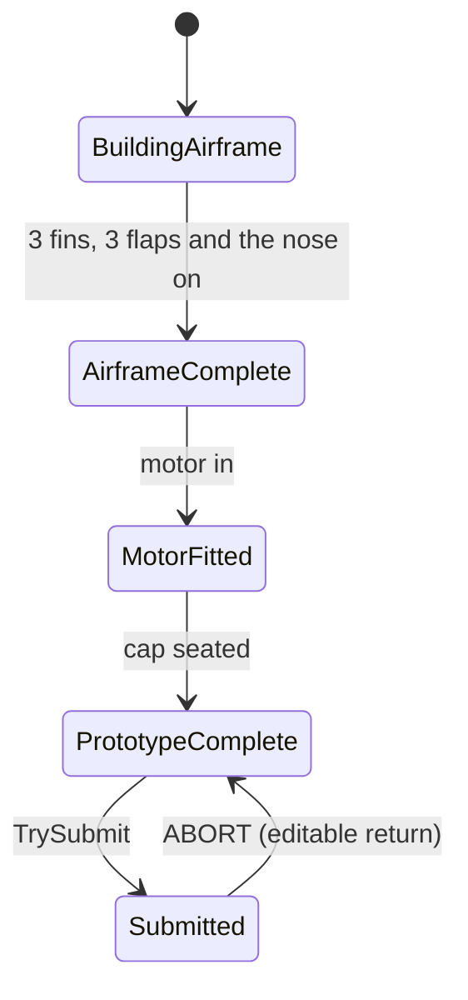

# 03 Rocket kit and assembly

The rocket parts, how they are grabbed and attached, the motor cap twist, the build rules, and the build report that decides the launch. This is the biggest system in the project and every part of it is built on the XR Interaction Toolkit (XRI). Back to the [main spec](README.md).

| | |
|---|---|
| **Where in the Editor** | `VRRocket_Main` → `RocketWorkstation` (a prefab instance on the room's desk at (−0.30, 1.125, 2.76)) |
| **Prefabs** | `Assets/Prefabs/Rocket/`: `RocketWorkstation`, `BodyTube`, `TailFin`, `WingFlap`, `NoseCone`, `Motor`, `MotorCap`, `AssembledRocket_Static` |
| **Models** | `Assets/Models/Rocket/*.fbx` and `attach_points.json` |
| **Settings** | `Assets/Settings/Rocket/AssemblyTuning.asset` (distances, angles, times), `FeedbackLibrary.asset` (sounds and vibrations, [spec 09](09-feedback-audio-haptics.md)) |
| **Scripts** | `Assets/Scripts/Runtime/` (table in section 12) |
| **Tests** | Edit mode: `AssemblyStateMachineTests`, `BuildReportTests`, `CapTwistLogicTests`, `GuideMathTests`, `AttachPointGeneratorTests`. Play mode: `FinFlapMotorTests`, `NoseGuideTests`, `CapTwistTests`, `FullFlowTests`, `NearOnlyGrabTests`, `RespawnSafeZoneTests`, `GameFlowTests` |

## 1. The kit

| Part | Count | Names in the Hierarchy | Mass | Attaches to | Rule |
|---|---|---|---|---|---|
| Body tube | 1 | `BodyTube` | 0.2 kg | (carries everything) | 0.30 m long, about 34 mm wide; all 12 attach points are on it |
| Tail fin | 3 | `TailFin_1` to `_3` | 0.05 kg | `FinSlot_1` to `_3` at the base | any fin in any fin slot; the fin snaps straight |
| Wing flap | 3 | `WingFlap_1` to `_3` | 0.05 kg | 6 slots: `FlapSlot_Mid_1` to `_3` (correct) and `FlapSlot_Low_1` to `_3` (wrong) | fits either way up; correct is a **Mid** slot with the **swept edge toward the nose** |
| Nose cone | 1 | `NoseCone_1` | 0.08 kg | `NoseSeat` on top | is pulled gently onto the seat (magnetism) |
| Motor | 1 | `Motor_1` | 0.08 kg | `MotorSeat` at the bottom | the battery: + end into the tube only; held the wrong way up, nothing glows |
| Motor cap | 1 | `MotorCap_1` | 0.06 kg | `CapSeat` at the bottom | needs the motor first; seats unlocked, then must be **twisted until it clicks** |

`rocketScale = 1` in the tuning asset is the real model size. The meshes come from a BSD-licensed model rocket kit, cleaned up in Blender (see `Docs/ASSET_CREDITS.md`).

## 2. The `RocketWorkstation` prefab

Open `Assets/Prefabs/Rocket/RocketWorkstation.prefab` (double-click) to see:

```
RocketWorkstation          RocketAssembly, RocketWorkstation, PartRespawner, AssemblyFeedback
└─ ScaledRoot              scaled by AssemblyTuning.rocketScale at startup
   ├─ PartsTray
   │  ├─ BodyTube          (BodyTube.prefab, lying flat)
   │  ├─ TailFin_1..3      (TailFin.prefab)
   │  ├─ WingFlap_1..3     (WingFlap.prefab)
   │  ├─ NoseCone_1        (NoseCone.prefab)
   │  ├─ Motor_1           (Motor.prefab)
   │  └─ MotorCap_1        (MotorCap.prefab)
   ├─ RespawnPad           where dropped parts reappear
   └─ WorkstationBounds    trigger box 1.6 x 0.9 x 0.9 m: parts inside count as "on the desk"
```

The prefab's origin is the desk surface. In `VRRocket_Main` it sits on the room's `AssmblyArea/DeskTop` at (−0.30, 1.125, 2.76). The parts lie on the −x side (world x −0.85 to −0.15); dropped parts reappear on the pad at about (−0.05, 1.127, 2.61). The scene instance adds two **safe zones** to `PartRespawner`: the bin's trigger and the console shelf (`ConsoleAddOn/ConsoleZone`), so parts left there do not respawn.

The four root components:

| Component | Job |
|---|---|
| `RocketAssembly` | **The rocket's brain**: build state, which parts may be grabbed or attached, submission, returning the rocket, new kits, the build report. The only thing other systems talk to. |
| `RocketWorkstation` | Applies `rocketScale`, remembers where each part starts on the tray, and spawns a fresh kit there. Holds the six part prefabs for that. |
| `PartRespawner` | Brings dropped loose parts back (section 8). |
| `AssemblyFeedback` | Plays the sounds and vibrations of every assembly moment ([spec 09](09-feedback-audio-haptics.md)). |

### What is on every part

Open `TailFin.prefab` for example:

| Component | Job |
|---|---|
| `Rigidbody` | gravity on, continuous collision; interpolated while loose |
| a collider | box (fins, flaps), mesh (cap), capsule (tube) |
| `RocketGrabInteractable` | XRI's `XRGrabInteractable` plus one early event the guide needs. Movement type **Kinematic** for parts, **Instantaneous** for the tube (so a carried rocket never lags). Interaction layers: Default and RocketPart. |
| `XRGeneralGrabTransformer` | XRI's normal "follow the hand" |
| `GuideGrabTransformer` | **the guided attach mechanic** (section 4) |
| `RocketPart` | what the part is (type and id 1 to 3), its state (Free, Guided, Attached), which attach point it is on, which hand held it last, and its glow |
| `NearOnlyGrabFilter` | only a hand within 0.12 m may hover or grab it; rays never can (section 3) |
| `AssemblyGrabGate` | asks `RocketAssembly.CanGrab` before every hover and grab (section 3) |
| `ImpactAudio` | knock sounds when it hits something faster than 0.25 m/s |
| `MotorCapTwist` | cap only: the twist (section 5) |

Children: `Mesh` (the model) and `PartGlow` (an orange glow mesh, hidden until needed). The `BodyTube` instead has `AttachPoints` with the 12 attach points, each with its own `Glow` child. Glows use `Assets/Materials/Rocket/Glow.mat` (URP Unlit, HDR orange) and are tinted per frame through a property block.

## 3. Grabbing: who can grab what, and when

**Controls:** grab with the **grip** button. Parts are **near only**: the hand must be within 0.12 m of the part's collider. The controller rays can click the menu but can never pick up a part.

**Why a filter and not a layer:** the rig's hands are XRI `NearFarInteractor`s, one interactor doing both near grabbing and far casting, so an interaction layer cannot separate the two. `NearOnlyGrabFilter` measures from the hand itself (not its attach point, which jumps to the far ray's hit point) and refuses anything further than **Max Distance** (0.12 m, set on each part prefab). It always refuses ray and socket interactors.

**Interaction layers:** parts are on `Default` and `RocketPart`. The room's rig hands do not have `RocketPart` in the room scene; `XRRigAdapter` adds it at runtime ([spec 08](08-xr-rig-and-input.md)).

**`RocketAssembly.CanGrab` decides the rest** (asked by `AssemblyGrabGate` before every hover and every grab):

| Situation | Can it be grabbed? |
|---|---|
| Any phase other than Assembly (`interactionEnabled` is false) | nothing |
| The rocket has been submitted (frozen) | nothing |
| A loose part | yes |
| The working rocket's body tube | yes, always. Grabbing anywhere on the rocket grabs the whole rocket. |
| A part attached to the rocket while the rocket **rests** on the desk | no: the hand falls through to the rocket, so the whole rocket is picked up. **Except the unlocked battery cap**: it can always be gripped to twist it (pulling it off still needs the rocket held or on the stand) |
| The rocket, with the hand within **Cap Grab Priority Radius** (7 cm) of an unlocked seated cap | no: that hand takes the cap, so a hand reaching for the cap is never given the whole rocket |
| A part attached to the rocket while the rocket is **held in the other hand** | yes, if the build rules allow removing it (section 6). This is the **two-handed removal**: hold the rocket, pull the part off along its guide. |
| The inspection prototype (a failed rocket returned on the console) | only as a whole; its parts can never be taken off |

**One physical object:** when a part seats, `RocketAssembly` copies its colliders onto a new child of the tube called `Compound_<part name>`. The tube's single rigidbody then carries the whole rocket's shape: it rests on its fins and gets pushed as one piece. The part keeps its own (kinematic) body and collider only so it can be hovered for removal. The copies are deleted when the part comes off.

**Parts never collide with each other.** `RocketAssembly.ApplyPartCollisionRules` turns off collisions between every pair of rocket parts, so a held part cannot shove the tube around or knock attached parts. Parts still collide with the desk, the floor and the room.

**Attached parts stay glued on.** Unity does not drag a child rigidbody along when its parent is moved by physics (carried, falling, settling). `AttachedPartSync`, added to the tube at startup, puts every attached part back on its seat after each physics step, in `LateUpdate`, and once more just before rendering (after XRI's own pre-render update). A held part (being pulled off or twisted) is left to the hand.

## 4. The guided attach mechanic

All parts share one mechanic, in `GuideGrabTransformer`. It runs inside XRI's grab: XRI computes where the hand wants the part, and the guide overrides that pose while the part is near a point.

**Step by step, for a fin:**

1. **Free.** The fin follows the hand.
2. **Approach.** The nearest attach point that would accept the fin, within **Glow Radius** (0.12 m), starts to glow, brighter the closer the fin gets: only that one, the slot the fin would go into. The fin's own glow lights up too. The light moves to another slot only once that one is **Glow Switch Margin** (1 cm) closer.
3. **Capture.** When the fin is within **Capture Radius** (0.05 m) of the nearest accepting point, and roughly the right way round (within 40° for fins and flaps, 45° for the other parts), it locks onto that point's **guide**: a short straight rail. The fin turns to its seated rotation, eased over **Guide Blend Duration** (0.1 s) so nothing jumps. A soft tick and a light pulse play ("guide engaged").
4. **Slide.** While guided, the fin can only slide along the rail, between the seat and the **guide length** (0.05 m for fins and flaps). The point glows at full brightness. A tiny haptic tick plays every 4 mm of travel, like a slot's texture.
5. **Break away.** Moving the hand more than **Break Radius** (0.08 m) sideways, or pulling back past the end of the rail, releases the guide. No sound or vibration, on purpose.
6. **Seat.** Letting go while guided: the fin glides onto the seat over **Seat Duration** (0.12 s; the motor 0.30 s), becomes kinematic and a child of the attach point. A click and a firm pulse play. `RocketAssembly` records it.
7. **Remove.** Grabbing an attached fin (with the rocket held in the other hand) puts it back on the rail at the seat. Pulling it past the rail's outer end takes it off ("unseat" sound and pulse). Let go and it is a loose part again.

**The rail's direction** (`AttachPoint.GuideAxisWorld`, always pointing away from the seat):

| Point | Rail runs |
|---|---|
| Fin and flap slots | straight out from the tube (the slot's +Z) |
| Nose seat | up, along the tube (+Y) |
| Motor seat, cap seat | down, along the tube (−Y) |

**"Roughly the right way round"** compares the part's forward axis with the slot's (fins, flaps), or the part's up axis with the seat's (nose, motor, cap).

**The seated rotation** (`GuideMath.SeatedRotation`):

- **Fins:** exactly the slot's rotation (a slightly crooked fin snaps straight).
- **Flaps:** the slot's rotation, or that rotation flipped upside down, whichever is closer to how it is held. So a flap fits either way up, and the build report later reads which way it went.
- **Nose, motor, cap:** the part's axis lines up with the tube; its spin around the axis is kept.
- It is kept relative to the attach point, not the room: a rocket turned in the other hand while a part is on its track keeps the part straight in it, and it seats straight.

**Special cases:**

- **The battery (the motor part) goes in only once it is in, and then always goes in straight:**
  - it is caught **only once its + end is inside the tube's base**: past the tube's end (a few millimetres or most of the way in, either counts), within **Motor Entry Radius** (2 cm: the opening plus a little give) of the tube's axis, and leaning no more than **Motor Entry Tilt** (60°). Nothing happens before that: no snap, no turning in mid-air. The seat glows as its + end approaches (within **Glow Radius**, 12 cm);
  - caught, it straightens onto the tube's axis over 0.1 s **without moving in or out**: its + end stays as far in as the hand put it. From then on it runs only along the axis, as far in as the hand holds its + end; drifting or leaning the hand, or turning the rocket, never takes it off the axis or through the wall;
  - **let go while it is in**, it slides home straight (**Seat Duration Motor**, 0.3 s). **Let go outside the base**, it simply drops;
  - pulled back out until its + end is **Motor Exit Margin** (1 cm) past the tube's end, it comes off the track (an attached battery, grabbed to take it out, comes off the same way);
  - **held the wrong way up** (it goes in + end up), or leaning more than 60°: no glow, no catch, and within **Motor Block Radius** (4 cm) of the axis it is held out below the tube's end, with one buzz, instead of passing into the tube;
  - its glow ring is on its **+ end**, the end that goes into the tube.
- **Nose magnetism:** the nose is drawn toward its seat. Near the seat it is shown at **Nose Magnetism** (50%) of the hand's distance; at the rail's outer end it follows the hand exactly.
- **A refused point** (gating says no, section 6) behaves as if it were not there: no glow, no snap.

## 5. The battery cap twist

The cap is guided onto `CapSeat` like any part, but it seats **unlocked**: it rests 2 mm proud of the tube (**Cap Unlocked Gap**). An unlocked cap makes the launch fail (the motor shoots out).

**Twist hint** (playtesters could not tell the cap needs turning): while the cap is seated but not locked on the rocket being built, an orange curved arrow (`TwistHint`, a child of the cap seat, drawn with the glow material) circles the cap in the direction it locks, clockwise viewed from below, and the cap's own glow pulses. Both go the moment it locks. `MotorCapTwist`: **Show Twist Hint**, **Hint Speed** (120 degrees per second), **Hint Radius** (2.6 cm), **Hint Color**. The bin monitor's READY screen also asks "Cap twisted until it clicks?" (always, so it gives nothing away).

To lock it:

1. Grip the seated cap. It does not come off; it stays on the rocket.
2. Twist the wrist. The cap turns about the rocket's axis by the **twist of the hand's rotation about that axis** (swing-twist decomposition: tilting the hand does not count), times **Cap Twist Sensitivity** (1.5), so one comfortable wrist turn of 120° closes it. Like the XRI example knob, everything is worked out in the seat's own frame: the cap turns about the tube's **current** axis however the rocket has been turned since the cap went on, and it is left square to the tube when let go. While it is twisted it is placed directly every frame (Instantaneous), not through physics.
3. It turns **clockwise only, viewed from below**. It is a ratchet: turning back does not unwind it, and progress is kept if you let go and grab again.
4. Every **30°** of new progress (**Cap Detent Angle**): a ratchet tick (sound and pulse). Between ticks, a very light "thread" texture every 6°.
5. At **180°** (**Cap Lock Angle**): it locks with a firm click and a strong pulse. The 2 mm gap closes over 0.1 s. A locked cap cannot be turned or removed.
6. Let go after **Cap Auto Finish Fraction** (75%, 135°) of the turn and it finishes the lock by itself, with the click.

**Taking an unlocked cap off:** with the rocket held in the other hand or on the stand, pull it more than 6 cm (**Cap Pull Off**), mostly along the axis (sideways drift while twisting never pulls it off). Its progress resets to zero.

**If the thread turns the wrong way in the headset:** untick **Clockwise From Below Is Negative Yaw** on `MotorCapTwist` in `MotorCap.prefab`.

The ratchet maths (`CapTwistLogic`) is plain C# with its own edit-mode tests.

## 6. Build rules: the assembly state machine

`AssemblyStateMachine` (plain C#, inside `RocketAssembly`) counts what is attached and derives a state:



The state is recalculated from the counts every time a part seats or comes off, so taking parts off moves it back. The rule, in order: submitted → **Submitted**; any of the 3 fins, 3 flaps or the nose missing → **BuildingAirframe**; battery and cap in → **PrototypeComplete**; battery in → **MotorFitted**; otherwise **AirframeComplete**. So **PrototypeComplete means all nine parts** (the cap may still be unlocked: that is a launch failure to discover, not a missing part). `AssemblyStateMachine.MissingParts()` and `DescribeMissing()` name what is still needed ("2 fins, the nose cone and the battery").

**Build order is free** (`Enforce Order` off in the tuning asset, Praise's decision on 11 October 2026). What still applies:

| Part | Can attach | Can come off |
|---|---|---|
| Fins, flaps, nose | any time | any time (two-handed) |
| Motor | any time | not while the cap is on |
| Cap | only when the motor is in | only if not locked |
| Anything, after submission | no | no |

With **Enforce Order** on, the old strict order returns: the motor only fits once the airframe is complete, and fins, flaps and the nose can neither be added nor removed once the motor is in.

`RocketAssembly.RefreshGating` pushes these rules into every attach point (`AttachPoint.gatingAllows`) whenever something changes. Points of the inspection prototype never accept anything.

**An unfinished rocket** can be put in the bin and SUBMIT pressed: the bin takes it for a moment (`TryTakeIncomplete`: frozen, sinks 30 cm), the screens say PARTS MISSING with the list, and it comes back up on its spot on the workbench, next to the parts still on the tray, editable (`ReturnIncomplete`). It is not launched and does not count as a flight ([spec 07](07-console-and-bin.md)).

## 7. The build report

`RocketAssembly.TrySubmit` reads the rocket at the moment of submission and builds a `BuildReport` (plain C#, `BuildReport.cs`):

| Field | Meaning |
|---|---|
| `flapPlacement[3]` | for each flap (id 1 to 3): slot name, position (`Midpoint` for a Mid slot, `Base` for a Low slot or no slot), orientation (`Up` = swept edge toward the nose, `Down`) |
| `capLocked` | the cap is twisted to 180° |
| `FlapError` | any flap not on a Mid slot with its swept edge up |
| `outcome` | `MotorRetentionLoss` if the cap is not locked (checked first); otherwise `UnstableFlight` if any flap is wrong; otherwise `Success` |
| `failedComponents` | for example `{ "MotorCap", "WingFlap_2" }` |
| `FailedCount` | how many failed |
| `wrongFlapCount` | flaps in the wrong place or upside down (one veers off course, more break up) |
| `parts` | every part on the rocket: type, id, the point it is on, and whether it is upside down (flaps). The launch vehicle is built from it ([spec 04](04-launch-simulator.md)) |

A flap that is missing counts as `Base`/`Down` (wrong). Which way up a flap sits is read from its rotation compared with its slot (`GuideMath.FlapOrientationFor`).

## 8. Respawning, returning and new kits

**Dropped loose parts** (`PartRespawner`, every frame):

- A loose part that is not held and is outside `WorkstationBounds` and every safe zone for **Respawn Delay** (1.5 s) reappears on `RespawnPad`.
- A part that falls below the floor line (0.5 m below the pad) respawns at once, unless it is inside a safe zone (the bin shaft is below that line).
- Respawned parts are laid out in a little grid on the pad (3 columns, 8 cm apart), at rest, with a soft "pop".

**The dropped rocket** (`RocketAssembly.Update`): the working rocket, out of bounds and not held, goes back to the tube's original spot on the tray after the same delay. A dropped **inspection prototype** goes back to where it was returned.

**Submitting** (`TrySubmit`, called by the bin, [spec 07](07-console-and-bin.md)): only when the state is PrototypeComplete (all nine parts) and the rocket is not held. It builds the report, marks the machine submitted, freezes the rocket (kinematic) and raises `Submitted`.

**Returning** (`ReturnPrototype`, called by the game engine):

| Mode | When | What happens |
|---|---|---|
| `Editable` | ABORT | the same rocket goes back to its spot on the desk with all its parts, unfrozen and editable; the state leaves Submitted |
| `InspectOnly` | failed launch (the previous inspection prototype is removed when the next rocket is submitted, so at most two rockets exist: the one being built and the last failed one) | the rocket is placed on the side desk under the moon-landing painting (the game engine's Failed Rocket Spot), lying along the desk, as the **inspection prototype**: it can be picked up and examined, never changed, and its guide is switched off. The workstation no longer owns it as the working rocket. |

**A new kit** (`BeginNewBuild`, after every launch): the loose parts and the working rocket are destroyed (not the inspection prototype), and a fresh tube and nine parts are spawned from the prefabs in the `RocketWorkstation` component, in the places they started. Both hands get a soft pulse ("kit spawned").

## 9. Events: how the rocket reports

**`RocketAssembly` events** (each also a UnityEvent for the Inspector):

| C# event | UnityEvent | When |
|---|---|---|
| `StateChanged(AssemblyState)` | `onStateChanged` | the build state changed |
| `PartAttached` | `onPartAttached` | a part seated on the working rocket |
| `PartRemoved` | `onPartRemoved` | a part came off the working rocket |
| `Submitted(BuildReport)` | `onSubmitted` | `TrySubmit` succeeded |
| | `onPrototypeComplete` | the rocket became complete |

**`AssemblyEvents`** is a static class for small moments, raised by the parts and heard by `RocketAssembly` and `AssemblyFeedback`: `GuideEngaged`, `GuideReleased`, `PartSeated`, `PartRemoved`, `PartRespawned`, `CapDetent`, `CapLocked`, `PrototypeComplete`, `PartImpact`, `PartHovered`, `PartGrabbed`, `PartReleased`, `GuideSlideTick`, `TwistTexture`, `KitSpawned`. Because it is static, it is cleared automatically every time Play mode starts.

The full public interface of `RocketAssembly` is listed in `Docs/INTEGRATION.md` section 2.

## 10. The tuning asset

Select `Assets/Settings/Rocket/AssemblyTuning.asset`. Distances are in metres at `rocketScale` 1 and scale with it.

| Field | Value | What it does |
|---|---|---|
| Rocket Scale | 1 | size of the whole kit. Try 1.5 if parts feel fiddly in the headset. |
| Glow Radius | 0.12 | the nearest fitting point starts glowing within this distance |
| Glow Switch Margin | 0.01 | the light moves to another point only once that one is this much closer |
| Capture Radius | 0.05 | a part locks onto a point's rail within this distance |
| Break Radius | 0.08 | sideways drift that releases the rail |
| Guide Length Plates / Nose / Motor / Cap | 0.05 / 0.06 / 0.08 / 0.04 | length of each rail |
| Guide Length Tube | 0.10 | unused (belonged to the removed assembly stand) |
| Orientation Tolerance Plates / Others | 40° / 45° | how crooked a part may be held and still be captured |
| Seat Duration / Seat Duration Motor | 0.12 s / 0.30 s | the glide onto the seat |
| Nose Magnetism | 0.5 | how strongly the nose is drawn to its seat |
| Guide Blend Duration | 0.1 s | easing between free and guided poses |
| Cap Lock Angle | 180° | twist needed to lock the cap |
| Cap Detent Angle | 30° | twist between ratchet ticks |
| Cap Unlocked Gap | 0.002 | how proud an unlocked cap sits |
| Cap Pull Off | 0.04 | pull needed to take off an unlocked cap |
| Enforce Order | off | the strict build order (section 6) |
| Stand Clearance | 0.2 | unused (removed stand) |
| Respawn Delay | 1.5 s | time out of bounds before a part respawns |
| Near Grab Distance | 0.12 | not read by the code: the near-only distance is **Max Distance** on each part's `NearOnlyGrabFilter` |

## 11. Attach points

The 12 points are children of `BodyTube/AttachPoints` in `BodyTube.prefab`. The tube's local +Y points to the nose; a point with yaw 0 faces local +Z.

| Point | Accepts | Height on the tube (y, m) | Yaw |
|---|---|---|---|
| `FinSlot_1`, `_2`, `_3` | tail fin | 0.035 | 0°, 120°, 240° |
| `FlapSlot_Low_1`, `_2`, `_3` | wing flap (wrong place) | 0.109 | 60°, 180°, 300° |
| `FlapSlot_Mid_1`, `_2`, `_3` | wing flap (correct place) | 0.150 | 0°, 120°, 240° |
| `NoseSeat` | nose cone | 0.300 | 0° |
| `MotorSeat` | motor | −0.011 | 0° |
| `CapSeat` | motor cap | 0.000 | 0° |

They are generated from `Assets/Models/Rocket/attach_points.json` and must not be edited by hand. To regenerate: open `BodyTube.prefab`, select the `BodyTube` root, run **VR Rocket > Generate Attach Points On Selected BodyTube**, save the prefab. It updates existing points in place. `AttachPointGeneratorTests` checks the generator against the JSON (12 points, positions, rotations, +Z pointing outward) and that running it twice adds no duplicates.

## 12. Scripts

All in `Assets/Scripts/Runtime/`, namespace `VRRocket`:

| Script | Role |
|---|---|
| `RocketAssembly.cs` | the brain: state, grab permission, gating, compound colliders, report, submit, return, new kit |
| `AssemblyStateMachine.cs` | states and build rules (plain C#) |
| `BuildReport.cs` | report and outcome rule (plain C#) |
| `RocketWorkstation.cs` | scale, tray layout, spawning kits |
| `PartRespawner.cs` | bounds, safe zones, respawn pad |
| `RocketPart.cs` | identity, state and glow of one part |
| `AttachPoint.cs` | one attach point: what it accepts, its rail, its glow; registry of all points |
| `GuideGrabTransformer.cs` | the guided attach mechanic |
| `GuideMath.cs` | the geometry of the guide (plain maths, tested) |
| `MotorCapTwist.cs`, `CapTwistLogic.cs` | the cap twist and its ratchet |
| `IAttachedGrabHandler.cs` | lets a part (the cap) take over what happens when its attached self is grabbed |
| `AttachedPartSync.cs` | keeps attached parts on the moving rocket |
| `RocketGrabInteractable.cs` | `XRGrabInteractable` with an extra early event |
| `AssemblyGrabGate.cs`, `NearOnlyGrabFilter.cs` | XRI hover and select filters |
| `ImpactAudio.cs` | knock sounds |
| `AssemblyEvents.cs` | the static event hub |
| `AssemblyTuning.cs`, `PartType.cs` | the tuning asset, the part and state enums |
| `AssemblyFeedback.cs`, `FeedbackLibrary.cs` | sound and haptics ([spec 09](09-feedback-audio-haptics.md)) |
| `OutcomeReadoutStub.cs`, `SubmissionZoneStub.cs` | old test stubs, used only in `Dev_Interactions` |

**Dormant code from the removed assembly stand:** an attach point named `StandClamp` would accept the body tube, and `FeedbackLibrary` has stand haptics. No `StandClamp` exists anywhere in the project, so this code never runs.

## 13. Recipes

**Make the parts bigger for testing in the headset.** Set Rocket Scale to 1.5. All distances scale with it.

**Make capture easier.** Raise Capture Radius (for example 0.07) and the orientation tolerances.

**Bring back the strict build order.** Tick Enforce Order.

**Make the cap lock with less twist.** Lower Cap Lock Angle (keep it a multiple of Cap Detent Angle so the last tick is the lock).

**Change a part's look.** Edit its prefab's `Mesh` child (or its material in `Assets/Materials/Rocket`, for example `Rocket_Orange.mat`). Keep the root's collider roughly matching the new shape.

## 14. Troubleshooting

| Symptom | Check |
|---|---|
| Nothing can be grabbed | Press START first (parts are locked in the menu). Are the hands within 12 cm? Do the hands have the `RocketPart` interaction layer (`Rig_Is_Adapted` test)? |
| A part follows the far ray | Must not happen: check the part still has `NearOnlyGrabFilter`. |
| A point does not glow | The part is the wrong way round, the point is already taken, or the build rules refuse it (the cap needs the motor; with Enforce Order on, more rules apply, section 6). |
| Grabbing a fin on the resting rocket picks up the whole rocket | By design. Hold the rocket in the other hand to take a part off. |
| A part will not come off | Pull further along its rail (more than the guide length). The motor cannot come out with the cap on; a locked cap never comes off. |
| Parts lag behind or float off the carried rocket | `AttachedPartSync` must be on the tube (added at startup). `AttachedParts_DoNotLagBehindTheRocket_FrameByFrame` tests this. |
| Parts keep jumping back to the pad | They are out of `WorkstationBounds` and safe zones. Move the workstation or widen the bounds box. |
| The cap twists the wrong way | Section 5, last paragraph. |
| The outcome looks wrong | The failure screen lists the failed parts. For the full report, log it from a test or a temporary script: `Debug.Log(JsonUtility.ToJson(flow.lastReport))`. A flap counts as correct only on a Mid slot with its swept edge up. |
