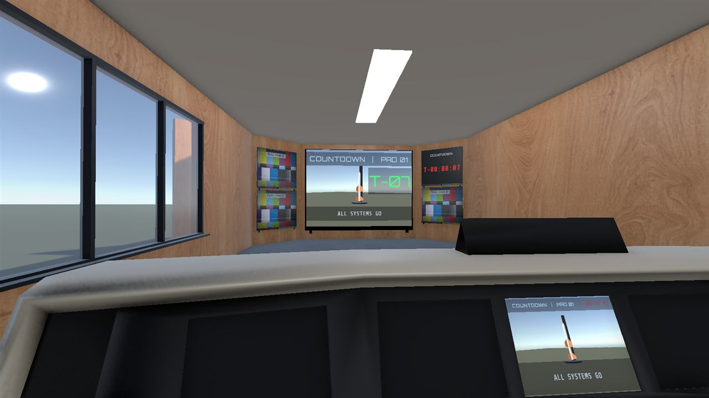
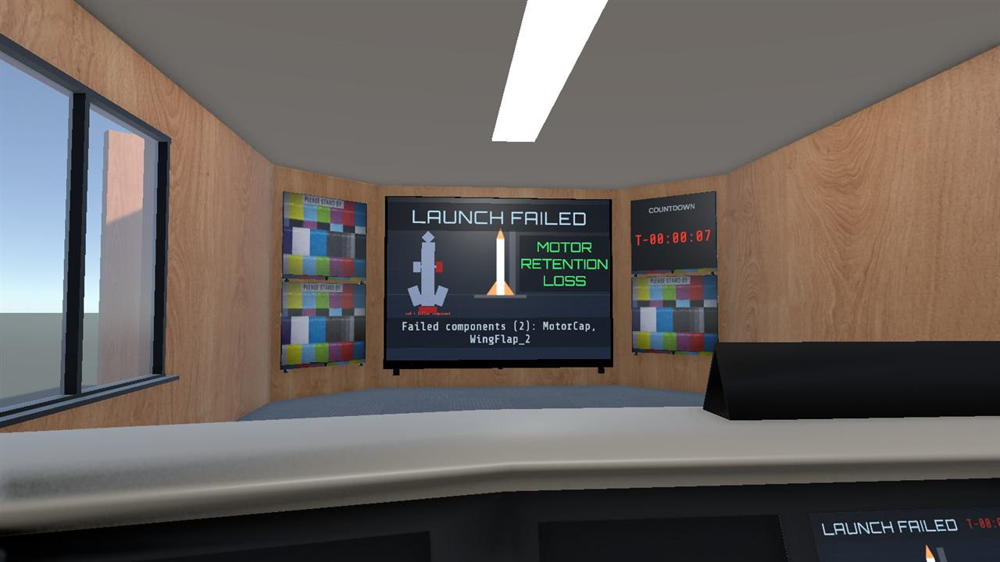

# 05 Screens and displays

Everything the game writes on a screen: the overlay on the big TV, the countdown clock, the console monitor, the blueprint panel above the desk, and the help board. Back to the [main spec](README.md).

| | |
|---|---|
| **Where in the Editor** | `VRRocket_Main` → `LaunchScreen`, `CountdownClock`, `ConsoleAddOn/ConsoleMirror`, `BlueprintPanel`, `HelpWall` |
| **Drivers** | `LaunchScreenController` and `BlueprintDisplay`, both on `GameFlow`; `PhaseDisplays` on `GameFlow` switches them on and off |
| **Scripts** | `Assets/Scripts/Runtime/LaunchScreenController.cs`, `BlueprintDisplay.cs`, `PhaseDisplays.cs` |
| **Assets** | `Assets/UI/Fonts/` (Orbitron, Share Tech Mono), `Assets/Materials/Screens/` (`Mat_LaunchScreen`, `Mat_ScreenBand`, `Mat_Black`, `Mat_PadFeed`, `Mat_Diagram`), `Assets/Materials/Environment/Mat_Whiteboard.mat` |
| **Tests** | `ScreenTextTests` (edit mode), `GameFlowTests` and `RoomIntegrationTests` (play mode) |

## 1. Who writes what

| Screen | Object | Written by | Shown |
|---|---|---|---|
| Big TV overlay | `LaunchScreen` | `LaunchScreenController` | every phase except Menu |
| Countdown clock (small TV top right of the big TV) | `CountdownClock` | `LaunchScreenController` (its Clock text) | every phase except Menu |
| Console monitor | `ConsoleAddOn/ConsoleMirror` | `LaunchScreenController` (the "mirror") | every phase except Menu |
| Blueprint panel above the desk | `BlueprintPanel` | `BlueprintDisplay` | always |
| Help board | `HelpWall` | nobody: fixed text | always |

During the menu the room's own TVs show the room's intro, so our overlays are switched off by `PhaseDisplays` ([spec 02](02-game-engine.md)).

All screen texts are **TextMeshPro 3D texts** (`TextMeshPro`, not UI). They live in the world like any mesh, so no Canvas is involved.

## 2. The big TV overlay (`LaunchScreen`)

`LaunchScreen` sits just in front of the room's big TV and follows it if the TV moves ([spec 01](01-scenes-and-room.md)). Its children, all in the TV's plane:

| Child | What it is |
|---|---|
| `ScreenSurface` | a quad the size of the TV's screen (4.364 × 3.149 m). Its material is swapped: `Mat_LaunchScreen` (a dark placeholder) or `Mat_PadFeed` (the pad camera's live picture) |
| `TitleBand`, `ScreenTitle` | the top band (translucent black, `Mat_ScreenBand`) and the title text (Orbitron, auto-size) |
| `StatusBand`, `ScreenStatus` | the bottom band and the status text (Share Tech Mono, auto-size) |
| `ScreenCountdown`, `BigBackdrop` | the big text (Orbitron), on the right half of the screen, and a dark backdrop behind it that only shows while the big text has something to say (countdown digits, result) |
| `Diagram` | the failure diagram on the left half: a flat rocket drawn from quads named `Diag_Tube`, `Diag_Nose`, `Diag_Fin1..3`, `Diag_Flap1..3`, `Diag_Cap`, plus `DiagLabel` and `DiagLegend`. Shown only on a failed result. |

`BigBackdrop` and `Diagram` are saved switched off; the controller switches them on when needed.

## 3. `LaunchScreenController`

On `GameFlow`. Its fields:

| Field | Points at |
|---|---|
| Screen | `LaunchScreen/ScreenSurface` (its renderer) |
| Placeholder Material | `Assets/Materials/Screens/Mat_LaunchScreen.mat` |
| Pad Camera Material | `Assets/Materials/Screens/Mat_PadFeed.mat` (shows `PadCameraFeed.renderTexture`, [spec 04](04-launch-simulator.md)) |
| Title, Big, Status | `ScreenTitle`, `ScreenCountdown`, `ScreenStatus` |
| Clock | `CountdownClock/ClockText` |
| Status Sentences | **1**: the big TV shows only the first sentence of the status (0 would show all) |
| Big Backdrop | `LaunchScreen/BigBackdrop` |
| Mirror Screen, Mirror Title, Mirror Status, Mirror Clock | `ConsoleMirror/MirrorSurface`, `MirrorTitle`, `MirrorStatus`, `MirrorClock` |
| Diagram | `LaunchScreen/Diagram` |
| Diagram Ok, Diagram Failed | pale blue (0.85, 0.9, 1) and red (1, 0.15, 0.1) |

Any field can be left empty: the controller skips what it does not have.

### The stages

The game engine calls one `Show...` method per moment. Each one sets every text, so a screen never shows leftovers.

| Method (phase) | Title | Big text | Status | Clock | Surface |
|---|---|---|---|---|---|
| `ShowTitle` (Menu) | VR ROCKET, or MISSION SUCCESS | | "Build it. Submit it. Launch it.", or "Flight 3 reached orbit insertion. Press START to build another." | T-00:00:00 | placeholder |
| `ShowAssembly` (Assembly) | ASSEMBLY \| BUILDING AIRFRAME (or AIRFRAME COMPLETE, MOTOR FITTED, PROTOTYPE COMPLETE) | | the hint from the game engine | T-00:00:00 | placeholder |
| `ShowReceived` (PreLaunch) | PROTOTYPE RECEIVED | | "Scaling for launch..." | T-00:00:00 | pad camera |
| `ShowPreLaunch` (PreLaunch, pad ready) | PROTOTYPE RECEIVED \| PAD 01 READY | | "Press LAUNCH to begin the countdown. ABORT returns the prototype." | T-00:00:10 | pad camera |
| `ShowCountdown(n)` (Countdown) | COUNTDOWN \| PAD 01 | T-10 ... T-01 | ALL SYSTEMS GO, then IGNITION from T-03 | T-00:00:10 ... | pad camera |
| `ShowFlight` (Launch) | LIFTOFF \| PAD 01 | | "T+12.4 s     ALT 812 m     VEL 145 m/s" | T+00:00:12 | pad camera |
| `ShowResult` (Result) | MISSION SUCCESS, or LAUNCH FAILED | NOMINAL FLIGHT, or MOTOR RETENTION LOSS, or UNSTABLE FLIGHT | "Clean launch. Well built.", or "Failed components (2): MotorCap, WingFlap_2 \| The prototype is returned for inspection. A new kit is on the bench." | unchanged | placeholder; the diagram on a failure |

### The console mirror

Players stand at the console, 11 m from the big TV, so `ConsoleMirror` repeats it on the console's centre monitor at reading distance. The controller writes the mirror together with the big TV:

- the same surface (placeholder or pad camera), title and clock;
- the **full** status text, while the big TV shows only its first sentence.

### First sentence only

`LaunchScreenController.FirstSentences(text, count)` cuts a text after `count` sentences. A sentence ends at a full stop followed by a space (". ") or at a " | " separator. Examples with Status Sentences = 1:

| Full text (console mirror) | Big TV |
|---|---|
| "Turn around: the kit is on the desk behind you. Fins at the base, ..." | "Turn around: the kit is on the desk behind you." |
| "Failed components (2): MotorCap, WingFlap_2 \| The prototype is returned ..." | "Failed components (2): MotorCap, WingFlap_2" |
| "T+12.4 s     ALT 812 m ..." (no ". ") | the whole text |

So: **put the most important part of any status text first.** `ScreenTextTests` covers this function.

### The failure diagram

On a failed result, `ShowResult` switches `Diagram` on and colours each quad with a material property block:

- `Diag_Cap` is red if the cap was not locked;
- `Diag_Flap1`, `Diag_Flap2`, `Diag_Flap3` are red if wing flap 1, 2 or 3 was wrong (the number is the flap's id, not the slot);
- everything else is pale blue.

Failed parts also glow brighter (emission × 2.5 against × 0.6). The diagram's material is `Assets/Materials/Screens/Mat_Diagram.mat`.

### Previewing a stage in the Editor

You do not need to play a whole game to see a stage. In edit mode, select `GameFlow`, click the **⋮** menu of the `LaunchScreenController` component, and choose **Preview > Title, Assembly, Received, Pre-launch, Countdown, Flight, Result success** or **Result failure**. The big TV and the console mirror show that stage in the Scene view (open `room.unity` additively to see them on the room's screens).

The game rewrites every screen when it starts, so a preview left in the scene does no harm when you save.

## 4. The countdown clock (`CountdownClock`)

Covers the screen of the room's small TV called `TV top left` (top right of the big TV as you look at it) and follows it. Children:

| Child | What it is |
|---|---|
| `ClockScreen` | black quad (`Mat_Black`) the size of that TV's screen (1.587 × 1.353 m) |
| `ClockLabel` | the word COUNTDOWN (LiberationSans) |
| `ClockText` | the clock (Share Tech Mono): `T-00:00:10` counting down, `T+00:00:12` during the flight |

It has no script of its own: `ClockText` is the Clock field of `LaunchScreenController`.

## 5. The blueprint panel (`BlueprintPanel`)

On the back wall above the assembly desk, at (0.85, 1.75, 3.885), 0.9 × 0.6 m. Children: `BlueprintFrame`, `BlueprintScreen` (`Mat_Black`) and `BlueprintText` (Share Tech Mono, auto-size).

`BlueprintDisplay` (on `GameFlow`) writes the text:

| When | Text |
|---|---|
| Menu | BLUEPRINT / standby |
| Assembly, fewer than 3 fins | STEP 1 / 5 TAIL FINS 0/3, "slide into the slots at the base, any order" |
| then fewer than 3 flaps | STEP 2 / 5 WING FLAPS n/3, "midpoint slots, swept edge toward the nose" |
| then no nose | STEP 3 / 5 NOSE CONE, "press it onto the top" |
| then no motor | STEP 4 / 5 MOTOR, "insert from below, nozzle down" |
| then no cap | STEP 5 / 5 MOTOR CAP, "seat it, then twist clockwise until it clicks" |
| everything on | COMPLETE, "carry the rocket to the bin and SUBMIT" |
| rocket on the pad | "Rocket on the pad. LAUNCH or ABORT at the console." |

The steps are worked out from the attached counts, in this order, whatever order the player builds in. The game engine calls `ShowState` on every build change, `ShowIdle` in the menu and `ShowText` for free text.

## 6. The help board (`HelpWall`)

A white board (`Mat_Whiteboard`) on the wall to the left as you face the desk, at (−3.88, 1.65, 0.80). `HelpText` is a fixed TextMeshPro text (LiberationSans, auto-size):

> **HOW TO BUILD**
> 1. Slide the three tail fins into the slots at the base.
> 2. Fit the three wing flaps at the midpoint, swept edge up.
> 3. Press the nose cone onto the top.
> 4. Insert the motor, nozzle down.
> 5. Twist the motor cap clockwise until it clicks.
>
> Carry the rocket to the bin on the console, press SUBMIT, then LAUNCH.
>
> **CONTROLS** grip: grab, trigger: menu, stick or trackpad: move and teleport

Edit it directly: select `HelpWall/HelpText` and change the Text field in the TextMeshPro component.

## 7. Recipes

**Change a font or colour on the screens.** Select the text object (for example `LaunchScreen/ScreenTitle`) and change the TextMeshPro component: Font Asset, Vertex Color, or Material Preset. The fonts are in `Assets/UI/Fonts`. The texts auto-size, so only the box size and the min and max sizes matter.

**Change a stage's words.** Edit the matching `Show...` method in `LaunchScreenController.cs` (and the hint texts in `GameFlowController.cs`, [spec 02](02-game-engine.md)). Keep the important part in the first sentence.

**Show the full status on the big TV.** Set Status Sentences to 0.

**Use your own launch screen.** Delete `LaunchScreen`, `CountdownClock` and `ConsoleMirror` (or clear the fields) and drive your screen from `GameFlowController.PhaseChanged` and `GameFlowController.lastReport`. See `Docs/INTEGRATION.md` section 4.

**Add a screen that hides during the menu.** Add it to Game Displays on `PhaseDisplays`.

## 8. Troubleshooting

| Symptom | Check |
|---|---|
| The big TV shows the room's own picture during the game | `LaunchScreen` is not switched on: check `PhaseDisplays` (and that `LaunchScreen` follows the TV, [spec 01](01-scenes-and-room.md)). |
| Our overlay floats away from the TV | The TV moved and `RoomBindings` could not find it; see the Console warning. |
| The screen is black where the pad should be | See the pad camera in [spec 04](04-launch-simulator.md). |
| Text is cut off on the big TV | By design only the first sentence shows there; the console monitor has the full text. |
| Text looks blurry or shimmers in the headset | MSAA must be on (4×) in the active URP asset ([spec 11](11-builds-and-deploy.md)). |
| A failed part is not red on the diagram | Only the cap and the flaps are drawn as failable; a quad must be named exactly `Diag_Cap` or `Diag_Flap1` to `Diag_Flap3`. |
