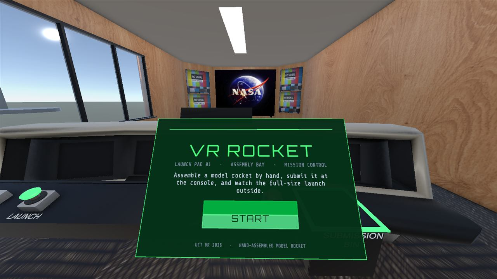

# 06 The start menu (styling guide)

Written for Richard, who is restyling the menu. It shows how the menu is built, the exact values it uses today, what code changes at runtime, and step-by-step recipes for restyling it without breaking the START button. Back to the [main spec](README.md).

| | |
|---|---|
| **Where in the Editor** | `VRRocket_Main` → `GameFlow` → `MenuCanvas` |
| **Script** | `MenuPanel` on `MenuCanvas` (`Assets/Scripts/Runtime/MenuPanel.cs`): shows and hides the menu, and sets three texts |
| **Called by** | `GameFlowController` on `GameFlow` ([spec 02](02-game-engine.md)) |
| **Assets** | Fonts: `Assets/UI/Fonts/` (`Orbitron SDF.asset`, `ShareTechMono SDF.asset`, the `.ttf` files and their OFL licences). Button sprite: `Assets/UI/Sprites/button_green.png` (Kenney, CC0) |
| **Tests** | `RoomIntegrationTests.Console_Buttons_And_Start_Are_Wired` (START is wired and the canvas takes XR rays), `GameFlowTests` (the menu shows, hides and comes back) |



## 1. Before you start

1. **Tell the team** you are editing `VRRocket_Main`. Scenes merge badly, so one person edits a scene at a time. Commit and push soon after.
2. Open `Assets/Scenes/VRRocket_Main.unity`.
3. Optional, to see the menu against the room: right-click `Assets/Scenes/room.unity` in the Project window > **Open Scene Additive**. Close it again **without saving** when you are done.
4. In the Hierarchy, expand `GameFlow` and select `MenuCanvas`. Press **F** with the mouse over the Scene view to frame it.

**Free to change:** colours, fonts, sprites, sizes, layout, the static texts, extra decoration, the menu's position.

**Keep working (or re-link if you change them):**

| Keep | Why |
|---|---|
| `MenuCanvas` with its `Canvas` set to **World Space** | it is a panel in the room, not a flat screen overlay (overlays do not work in VR) |
| `TrackedDeviceGraphicRaycaster` on `MenuCanvas` | lets the controllers' rays hit the menu |
| `CanvasGroup` on `MenuCanvas` | `MenuPanel` fades the whole menu with it |
| `MenuPanel` on `MenuCanvas`, with its four fields filled | it sets the texts and fades the menu (section 4) |
| `StartButton`'s **On Click ()** → `GameFlow` → `GameFlowController.StartGame` | this is what starts the game |
| `GameFlow/EventSystem` with `XRUIInputModule` | turns ray hits into clicks |

If you rename or replace `Title`, `Body` or `StartButton/Label`, drag the new objects into `MenuPanel`'s **Title**, **Body** and **Button Label** fields.

## 2. How the menu is built

```
GameFlow
└─ MenuCanvas        Canvas (World Space), CanvasScaler, TrackedDeviceGraphicRaycaster, CanvasGroup, MenuPanel
   ├─ Border         Image: the green frame (fills the whole canvas)
   ├─ Panel          Image: the dark glass (3 units inside the border, so 3 units of Border show around it)
   ├─ AccentBar      Image: the thin green line near the top
   ├─ Title          TextMeshPro - Text (UI): "VR ROCKET"            set by code
   ├─ Kicker         TextMeshPro - Text (UI): "LAUNCH PAD 01 · ..."  static
   ├─ Body           TextMeshPro - Text (UI): the description        set by code
   ├─ StartButton    Image (sliced sprite) + Button: On Click → GameFlowController.StartGame
   │  └─ Label       TextMeshPro - Text (UI): "START"                set by code
   └─ Footer         TextMeshPro - Text (UI): "UCT VR 2026 · ..."     static
```

UI draws in Hierarchy order: lower children draw on top of higher ones. That is why `Border` is first and `Panel` second.

### Size and units

- `MenuCanvas` is **1000 × 650** units with scale **0.001**, so it is **1.0 m × 0.65 m** in the room.
- **One canvas unit is one millimetre.** A font size of 31 means letters about 31 mm tall.
- Canvas Scaler: Constant Pixel Size, Scale Factor 1, Reference Pixels Per Unit 100, Dynamic Pixels Per Unit 1.

### Where it stands

| Rect Transform | Value | Meaning |
|---|---|---|
| Pos X, Pos Y, Pos Z | −0.40, 1.22, 0.10 | about 0.7 m in front of where the player starts, below the line of sight to the big TV, so the intro video shows above it |
| Rotation | (29.2, 180, 0) | turned to face the player (who starts facing the big TV), and tilted back so it faces up toward the eyes |
| Width, Height | 1000, 650 | |
| Scale | 0.001 | |

The menu is fixed in the room: it does not follow the player's head.

## 3. Every element's style today

Colours are given as Unity shows them in RGB 0–1 mode, with the hex value.

| Element | Rect (anchor, position, size) | Style |
|---|---|---|
| `Border` | stretched to the canvas edges | Image, no sprite. Colour (0.25, 0.9, 0.45), alpha 0.85: `#40E673` at 85% |
| `Panel` | stretched, 3 units inside on each side (Right/Bottom −6) | Image, no sprite. Colour (0.02, 0.045, 0.065), alpha 0.96: `#050B11` at 96% |
| `AccentBar` | anchored top centre, Pos Y −62, 860 × 4 | Image. Colour (0.3, 1, 0.5): `#4CFF80` |
| `Title` | centre, Pos Y 150, 900 × 110 | Orbitron SDF, size 82, colour (0.3, 1, 0.5) `#4CFF80`, character spacing 10, centred |
| `Kicker` | centre, Pos Y 78, 900 × 40 | Share Tech Mono SDF, size 26, colour (0.5, 0.6, 0.68) `#8099AD`, centred. Text: `LAUNCH PAD 01   ·   ASSEMBLY BAY   ·   MISSION CONTROL` |
| `Body` | centre, Pos Y −10, 820 × 120 | Share Tech Mono SDF, size 31, colour (0.8, 0.88, 0.95) `#CCE0F2`, centred, wraps |
| `StartButton` | centre, Pos Y −150, 440 × 120 | Image: sprite `button_green.png`, Image Type **Sliced**, colour (0.35, 0.92, 0.55) `#59EB8C` (the colour tints the sprite). Button: Transition **Color Tint**: Normal white, Highlighted (0.85, 1, 0.9) `#D9FFE6`, Pressed (0.55, 0.85, 0.65) `#8CD9A6`, Fade Duration 0.1 |
| `StartButton/Label` | centre of the button, Pos Y −16, 440 × 70 | Orbitron SDF, size 40, colour (0.02, 0.09, 0.04) `#05170A`, character spacing 8 |
| `Footer` | centre, Pos Y −275, 900 × 30 | Share Tech Mono SDF, size 20, colour (0.5, 0.6, 0.68) `#8099AD`. Text: `UCT VR 2026   ·   HAND-ASSEMBLED MODEL ROCKET` |

Only `StartButton`'s Image has **Raycast Target** on. Every other image and every text has it off, so nothing can block the ray. Keep it that way for anything you add.

**The fonts.** Both are TextMeshPro SDF font assets made from the `.ttf` files next to them, with a 1024 × 1024 **dynamic** atlas: characters are added when first used. Because of that, Unity may mark the two font assets as changed after you press Play. Do not commit that change unless you meant to edit the font.

**The button sprite.** `button_green.png` is 192 × 64 pixels, imported as a Sprite with 16-pixel borders for 9-slicing, so the corners stay sharp at any button size.

## 4. What the code changes at runtime

`MenuPanel` (on `MenuCanvas`) has four fields: **Group** (the `CanvasGroup`), **Title**, **Body**, **Button Label**, plus **Fade Seconds** (0.35).

**Three texts are overwritten every time the menu opens.** `GameFlowController` calls `MenuPanel.Show(title, body, buttonLabel)`:

| When | Title | Body | Button label |
|---|---|---|---|
| The game starts | VR ROCKET | Assemble a model rocket by hand, submit it at the console, and watch the full-size launch outside. | START |
| After a successful flight | MISSION SUCCESS | Your rocket flew clean. Build another? | BUILD AGAIN |

So:

- Text you type into `Title`, `Body` or `Label` in the Inspector is replaced in Play mode. To change these words, edit `EnterMenu` in `Assets/Scripts/Runtime/GameFlowController.cs` (or ask whoever works on the game engine).
- `Kicker` and `Footer` are never touched by code: edit them freely.
- Design for both states: "MISSION SUCCESS" is longer than "VR ROCKET", and "BUILD AGAIN" is longer than "START".

**Fading.** `Show` switches `MenuCanvas` on and fades the `CanvasGroup`'s alpha to 1 over 0.35 s. `Hide` (when the player presses START) fades it to 0, turns off Interactable and Blocks Raycasts so the hidden button cannot be clicked, and then switches `MenuCanvas` off. Anything you put under `MenuCanvas` fades and disappears with it.

## 5. Recipes

### Change a colour

1. Select the element (`Panel`, `Title`...).
2. Image: change **Color**. Text: change **Vertex Color** in the TextMeshPro component (or the colour gradient, outline and glow in its material settings).

For the button, remember the Image colour multiplies the sprite. Set it to white to see the sprite's own colours.

### Change a font

1. Copy the font's `.ttf` (or `.otf`) into `Assets/UI/Fonts/`, with its licence file.
2. Select the font file, then **Window > TextMeshPro > Font Asset Creator**. Atlas Resolution 1024 × 1024, Render Mode SDFAA, then **Generate Font Atlas** and **Save** next to the font. (Or right-click the font > **Create > TextMeshPro > Font Asset** (in some Unity versions **Font Asset > SDF**), which makes a dynamic font asset straight away.)
3. Select the text object and drag the new font asset into **Font Asset**.
4. Check special characters render: the Kicker and Footer use the middle dot `·`.

### Change the button's look

- **New graphic:** import the PNG into `Assets/UI/Sprites/`. In its import settings set Texture Type **Sprite (2D and UI)**, then open the **Sprite Editor** and drag the green border lines to the edges of the corners. Apply. Drag it into `StartButton`'s Image **Source Image**, keep Image Type **Sliced**.
- **Hover and press colours:** `StartButton` → Button → Transition **Color Tint**: Normal, Highlighted (ray pointing at it), Pressed, Selected, Disabled. Keep Highlighted clearly different: it is the player's only hint that the ray is on the button.
- **Sprites instead of tints:** set Transition to **Sprite Swap** and fill Highlighted Sprite and Pressed Sprite.

### Change the layout

- Use the **Rect Tool** (press **T**) in the Scene view, or type values into the Rect Transform.
- Keep everything inside the 1000 × 650 canvas, or resize `MenuCanvas`'s Width and Height. `Border` and `Panel` stretch with it; `AccentBar` stays anchored to the top.
- Keep body text at about 24 or more. At 0.7 m, smaller text gets hard to read in a headset. The Footer at 20 is the smallest we use.

### Add a logo or picture

1. Right-click `MenuCanvas` > **UI > Image**.
2. Set its Source Image, and drag it in the Hierarchy below `Panel` so it draws on top of the glass.
3. **Untick Raycast Target**, so it never blocks the START button.

### Add another button

1. Duplicate `StartButton` (Ctrl+D) and move it.
2. In its Button's **On Click ()**, replace `GameFlowController.StartGame` with your method.
3. Its label is static: `MenuPanel` only updates the START button's label.

### Move the menu

Select `MenuCanvas` and use the Move tool, or change Pos X, Pos Y, Pos Z in the Rect Transform. Keep it:

- 0.6 to 0.9 m in front of the spawn point (`Player` stands at (−0.4, floor, 0.78) facing −Z);
- below the line of sight from the spawn to the big TV, so the intro stays visible;
- tilted toward the eyes, so the ray hits it at a comfortable angle.

## 6. Check your work

1. **Look in edit mode.** The menu is visible in the Scene and Game views without pressing Play. With `room.unity` open additively you see it against the room.
2. **Check both states.** Type "MISSION SUCCESS" into `Title` and "BUILD AGAIN" into `Label` to check they fit, then put the old text back. (The code sets them in Play mode anyway.)
3. **Press Play.** The menu should appear over the room's intro. Clicking START needs a headset. Without one you can use XRI's **XR Device Simulator**: Edit > Project Settings > XR Plug-in Management > XR Interaction Toolkit > **Use XR Device Simulator in scenes**. That is a shared project setting: switch it off again before you commit.
4. **Run the tests.** Window > General > Test Runner > **PlayMode**, run `RoomIntegrationTests` and `GameFlowTests`. They fail if START is no longer wired or the canvas no longer takes XR rays.
5. **In the headset:** is it readable at arm's length, is START easy to hit with the ray, and is the highlight visible?
6. **Commit** only `VRRocket_Main.unity` and your new assets (sprites, fonts with `.meta` files).

## 7. Troubleshooting

| Symptom | Fix |
|---|---|
| The ray does not highlight or click START | `StartButton`'s Image must have Raycast Target on. Images on top of it must have it off. `MenuCanvas` needs `TrackedDeviceGraphicRaycaster`, and `GameFlow/EventSystem` needs `XRUIInputModule`. |
| START clicks but nothing happens | `StartButton` → **On Click ()** must have `GameFlow` with `GameFlowController.StartGame`. |
| My new title text is gone in Play mode | `Title`, `Body` and `Label` are set by code (section 4). |
| The menu does not appear in Play mode | `MenuPanel`'s **Group** field must point at the `CanvasGroup`; `MenuCanvas` must stay under `GameFlow`. |
| Squares instead of letters | The font asset has no such character. Use a font that includes it (dynamic font assets add characters automatically if the `.ttf` has them). |
| The button looks stretched or blurry at the corners | Image Type must be **Sliced**, and the sprite needs borders set in the Sprite Editor. |
| The menu is in the wrong place after Play | Set the position with Pos X/Y/Z in the Rect Transform (not by script on `transform.localPosition` alone). |
