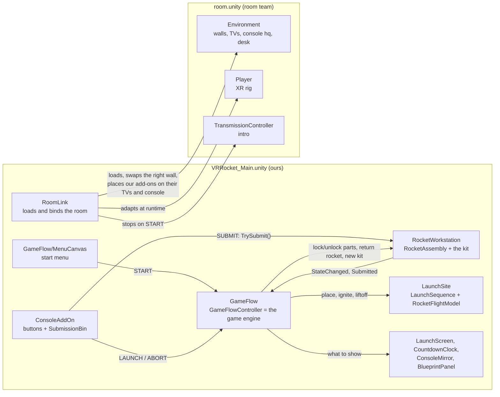

# VR Rocket: how the project is set up

Start here. This page explains the whole project from a high level and shows how the parts connect. Each part then has its own detailed spec, linked below. Read this page first and open a sub-spec when you need to change or debug that part.

The specs describe the project as it is on branch `interactions`, last checked against the code on 12 October 2026. When the code and a spec disagree, the code wins: please fix the spec in the same commit.

**All work now happens in `VRRocket_Final`** (since 13 October 2026): our game and Richard's updated room in one scene, with the intro on demand, a curtained window, BACK and NEXT on the desk, a wide console monitor and an abort alarm. [Spec 13](13-final-scene.md) covers what is different there. `VRRocket_Main` (our scene that loaded `room.unity` at runtime) is retired: it is kept for reference, no test or build uses it, and it is not refitted to Richard's new room. Where the other specs say `VRRocket_Main`, the same systems now live in `VRRocket_Final`; the parts about loading the room and `RoomBindings` no longer apply.

## Contents

| Spec | Read it when you want to... |
|---|---|
| [01 Scenes and the room](01-scenes-and-room.md) | understand the two scenes, how our scene loads `room.unity`, and what happens when the room changes |
| [02 The game engine (GameFlow)](02-game-engine.md) | follow the game from menu to launch to result, change timings or texts, or plug in a new system |
| [03 Rocket kit and assembly](03-rocket-assembly.md) | understand the parts, attach points, grabbing, the cap twist, the build rules and the build report |
| [04 Launch simulator](04-launch-simulator.md) | change the flight physics, the three launch outcomes, the pad, the vehicle or the pad camera |
| [05 Screens and displays](05-screens-and-displays.md) | change what the big TV, the corner clock, the console monitor, the blueprint panel or the help board show |
| [06 The start menu](06-menu.md) | restyle the start menu (written for Richard) |
| [07 Console buttons and the bin](07-console-and-bin.md) | understand SUBMIT, LAUNCH, ABORT and the submission bin |
| [08 XR rig and controls](08-xr-rig-and-input.md) | understand the player rig, the controls per headset, interaction layers and teleporting |
| [09 Feedback: glow, sound and haptics](09-feedback-audio-haptics.md) | change a sound or a vibration, or add feedback to a new event |
| [10 Testing and debugging](10-testing-and-debugging.md) | run the tests, or find out why something is broken |
| [11 Builds and deploying](11-builds-and-deploy.md) | build for PC VR or Quest 3 and install on the headset |
| [12 Project layout and editor tools](12-project-layout-and-tools.md) | find a file, learn the custom menus, and follow the project's conventions |
| [13 The final scene](13-final-scene.md) | work on `VRRocket_Final`, the scene we ship: our game in Richard's updated room, intro on demand, window curtain, BACK and NEXT, abort alarm |

## 1. What the player does

| Step | What happens | Spec |
|---|---|---|
| 1. Intro | The player starts where the room's `Player` rig stands, facing the big TV. The room's own intro plays (NASA logo, standby video, announcement, red alert lights, transmission video). The start menu floats in front of the player. | [06](06-menu.md), [01](01-scenes-and-room.md) |
| 2. Start | The player points at START and pulls the trigger. The intro stops, the room lights come back, our screens switch on and the rocket kit unlocks. | [02](02-game-engine.md) |
| 3. Build | The player turns around to the assembly desk. The kit lies on the desk: a body tube, 3 tail fins, 3 wing flaps, a nose cone, a motor and a motor cap. Parts slide onto glowing attach points. The cap must be twisted until it clicks. The blueprint panel above the desk shows the next step. | [03](03-rocket-assembly.md), [09](09-feedback-audio-haptics.md) |
| 4. Submit | The player carries the finished rocket to the console, drops it into the bin and presses SUBMIT. | [07](07-console-and-bin.md) |
| 5. Pad | The rocket appears on the launch pad outside the window at model size and grows to full size (36 times). The big TV and the console monitor show the pad camera. | [04](04-launch-simulator.md), [05](05-screens-and-displays.md) |
| 6. Launch | LAUNCH starts a 10 second countdown, the engine lights at T-3, then the rocket flies. ABORT (before liftoff) brings the rocket back to the desk to fix it. | [02](02-game-engine.md), [04](04-launch-simulator.md) |
| 7. Result | A good rocket climbs to 1200 m and the menu returns. A bad rocket fails the way it was built: an unlocked cap shoots the motor out on the pad, wrong flaps make it corkscrew and explode. The failed rocket comes back on the console for inspection, and a fresh kit appears on the desk. | [04](04-launch-simulator.md), [03](03-rocket-assembly.md) |

The rule that decides the outcome (in `BuildReport.Build`):

- cap not locked: **MotorRetentionLoss** (checked first, so it wins);
- otherwise any flap not on a middle slot with its swept edge up: **UnstableFlight**;
- otherwise: **Success**.

## 2. The big picture

The project has **two scenes that run together**.

- **`Assets/Scenes/VRRocket_Main.unity`** is ours and is the scene you press Play in. It holds every VR Rocket system.
- **`Assets/Scenes/room.unity`** is the room team's scene: walls, TVs, the console (`hq`), the desk, the `Player` rig and the intro (`TransmissionController`). We never edit or save it.

When you press Play, `RoomSceneLoader` (on the `RoomLink` object) loads `room.unity` next to our scene. Our systems then find the room's objects **by their Hierarchy path** and connect to them at runtime. Because of this, both teams can edit their own scene at the same time without merge conflicts. [Spec 01](01-scenes-and-room.md) explains this in detail.



In words:

- **`GameFlowController` is the game engine.** It is a component on the `GameFlow` object. It holds the current phase (Menu, Assembly, PreLaunch, Countdown, Launch, Result) and tells every other system what to do. It never touches a rocket part directly. See [spec 02](02-game-engine.md).
- **`RocketAssembly` is the rocket's brain.** It sits on the root of the `RocketWorkstation` prefab, keeps the build state, decides which parts may be grabbed or attached, and writes the build report. The flow only talks to the rocket through it. See [spec 03](03-rocket-assembly.md).
- **`LaunchSequence` is the launch.** It sits on `LaunchSite`, owns the full-size vehicle outside, and plays one of the three outcomes using `RocketFlightModel`, a small physics model in plain C#. See [spec 04](04-launch-simulator.md).
- **The console add-on is the input.** The three push buttons call `SubmissionBin.Submit`, `GameFlowController.Launch` and `GameFlowController.Abort`. See [spec 07](07-console-and-bin.md).
- **The screens are the output.** `LaunchScreenController` (also on `GameFlow`) writes the big TV, the console monitor and the corner clock. See [spec 05](05-screens-and-displays.md).

## 3. The Hierarchy of `VRRocket_Main` at a glance

Open `Assets/Scenes/VRRocket_Main.unity`. These are its root objects. Each is one self-contained module.

| Root object | What it is | Main components | Spec |
|---|---|---|---|
| `RoomLink` | The connection to the room | `RoomSceneLoader`, `RoomBindings`, `XRRigAdapter`, `TransmissionBridge` | [01](01-scenes-and-room.md) |
| `XR Interaction Manager` | The one XRI interaction manager (the room has none) | `XRInteractionManager` | [08](08-xr-rig-and-input.md) |
| `GameFlow` | The game engine and the big-screen driver | `GameFlowController`, `LaunchScreenController`, `BlueprintDisplay`, `PhaseDisplays`, `AudioSource` | [02](02-game-engine.md) |
| `GameFlow/EventSystem` | UI input for XR rays | `EventSystem`, `XRUIInputModule` | [08](08-xr-rig-and-input.md) |
| `GameFlow/MenuCanvas` | The start menu | `Canvas` (world space), `MenuPanel`, `CanvasGroup`, `TrackedDeviceGraphicRaycaster` | [06](06-menu.md) |
| `RocketWorkstation` | The rocket kit on the assembly desk (a prefab) | `RocketAssembly`, `RocketWorkstation`, `PartRespawner`, `AssemblyFeedback` | [03](03-rocket-assembly.md) |
| `BlueprintPanel` | The step-by-step screen above the desk | a `TextMeshPro` text driven by `BlueprintDisplay` | [05](05-screens-and-displays.md) |
| `HelpWall` | The white help board with build steps and controls | static text | [05](05-screens-and-displays.md) |
| `ConsoleAddOn` | Buttons, bin, console monitor and invisible colliders on the room's console. **Saved switched off on purpose**; it switches itself on at runtime. | `SubmissionBin`, 3 × `PushButton` prefab | [07](07-console-and-bin.md) |
| `LaunchScreen` | Overlay on the room's big TV | text, bands, failure diagram | [05](05-screens-and-displays.md) |
| `CountdownClock` | Overlay on the small TV top right of the big TV | text | [05](05-screens-and-displays.md) |
| `LaunchSite` | The pad, the 36× vehicle, effects, sounds and the pad camera | `LaunchSequence` | [04](04-launch-simulator.md) |
| `Outside` | Ground, launch pad disc and gantry tower | meshes and colliders | [04](04-launch-simulator.md) |
| `WindowWall` | Our copy of the room's right wall, with a window cut in. **Saved switched off on purpose.** | `WindowOpening` | [01](01-scenes-and-room.md) |
| `RoomFit/TeleportFloor` | Six thin boxes you can teleport onto | `TeleportationArea` | [08](08-xr-rig-and-input.md) |
| `Sun` | Directional light for the outside | `Light` | [01](01-scenes-and-room.md) |

There is also a second scene, `Assets/Scenes/Dev_Interactions.unity`: a grey test room with only the rocket kit and its own rig, used by most of the automated tests. See [spec 10](10-testing-and-debugging.md).

## 4. A map of the room

Top view, drawn the way the player sees the room at the start: facing the big TV. In Unity terms the TV is at −Z, so the window (+X) is on the player's **left** and the help board (−X) on the **right**.

```
                          FRONT WALL (z = -8.15)
        +-----------------------------------------------------+
        |            [ BIG TV + LaunchScreen ]   [clock TV]    |
        |                     x = 0              x = -3.1      |
        |                                                      |
   W    |                                                      |
   I    |                                                      |
   N    |  window in the left wall (x = 4),                    |
   D    |  from z = -6 to z = -0.5                             |
   O    |                                                      |
   W    |  console "hq" + our ConsoleAddOn (z -0.1 to -1.3)    |
        |  [ABORT] [LAUNCH]    [monitor]   [SUBMIT]   [BIN]    |
        |   x=1.4   x=1.05      x=0       x=-0.55   x=-1.05   |
        |                (start menu, z = 0.1)                 |
        |             * spawn (-0.4, 0.78)        [help board] |
        |                                          x=-3.88     |
        |        [ assembly desk, kit at x = -0.3 ]            |
        |          (z 2.4 to 3.9, desk top 1.125 m)            |
        +-----------------------------------------------------+
               BACK WALL (z = 4), blueprint panel at x = 0.85

    Outside, beyond the window: the launch pad at (32, 0.3, -20).
```

## 5. How the systems talk to each other

The project uses four simple wiring styles. Knowing them makes any bug easier to follow.

1. **Inspector references.** Most links are plain fields set in the Inspector. For example, select `GameFlow` and look at `GameFlowController`: its `Assembly`, `Bin`, `Launch`, `Screen`, `Menu`, `Blueprint` and `Audio` fields point at the objects it drives. Every component also has a `Configure(...)` method that sets the same fields from code.
2. **UnityEvents set in the Inspector.** Buttons call methods this way. The menu's START button has `On Click () → GameFlowController.StartGame`. Each console push button has `On Press → ButtonPressHaptics.OnPress` plus one game method.
3. **C# events between systems.** `RocketAssembly` raises `StateChanged`, `PartAttached`, `PartRemoved` and `Submitted`. `GameFlowController` raises `PhaseChanged`. Most of them also exist as UnityEvents (`onStateChanged`, `onSubmitted`, `onPhaseChanged`...), so you can hook them in the Inspector without code.
4. **A static event hub for part moments.** `AssemblyEvents` (a static class) carries small moments such as "guide engaged", "part seated", "cap detent" and "part hovered". Parts raise them without needing a scene reference. `RocketAssembly` listens to update the build state, and `AssemblyFeedback` listens to play sound and haptics.

**Example: what happens when the player presses SUBMIT.**

1. The player's hand pushes `ConsoleAddOn/ControlPanel/SubmitButton`. Its `XRPushButton` fires `On Press`, which calls `ButtonPressHaptics.OnPress` (a click in the hand) and `SubmissionBin.Submit`.
2. `SubmissionBin.Submit` checks that a complete, loose rocket is inside its trigger, then calls `RocketAssembly.TrySubmit()`.
3. `TrySubmit` reads the flaps and the cap, builds a `BuildReport`, freezes the rocket and raises `Submitted(report)`.
4. `GameFlowController` receives `Submitted`, switches to the **PreLaunch** phase, locks the kit, and calls `LaunchSequence.PlaceVehicleOnPad(2.5)` and `LaunchScreenController.ShowReceived()`.
5. Meanwhile the bin sinks the rocket out of sight, and `AssemblyFeedback` buzzes both hands.
6. After 2.5 s the vehicle is full size, the screen says "PAD 01 READY", and LAUNCH is now accepted.

## 6. Settings that live in assets

Several things you might want to tune are assets, not code. Change them in the Inspector, no programming needed.

| Asset | What it holds | Spec |
|---|---|---|
| `Assets/Settings/Rocket/AssemblyTuning.asset` | Every assembly distance, angle and time: glow and capture radius, guide lengths, cap twist angles, respawn delay, build order rule | [03](03-rocket-assembly.md) |
| `Assets/Settings/Rocket/FeedbackLibrary.asset` | Every assembly sound clip and every vibration (strength, length, pitch) | [09](09-feedback-audio-haptics.md) |
| `Assets/Settings/BuildProfiles/VRRocket_Windows.asset`, `VRRocket_Quest.asset` | The two build targets with their scene lists | [11](11-builds-and-deploy.md) |
| `Assets/Models/Rocket/attach_points.json` | Where each attach point sits on the body tube | [03](03-rocket-assembly.md) |

The flight physics numbers (thrust, mass, burn time...) are in code: `RocketFlightModel.cs`. Timings of the flow (countdown length, result time) are fields on `GameFlowController`. See [spec 04](04-launch-simulator.md) and [spec 02](02-game-engine.md).

## 7. Ground rules for working on the project

- **Never edit `room.unity` for VR Rocket work.** Put new things in `VRRocket_Main` (or a prefab) and connect to the room by path, as `RoomBindings` does.
- **Keep the room's object paths stable**, or tell whoever works on `VRRocket_Main`. The paths it depends on are listed in [spec 01](01-scenes-and-room.md). A renamed object does not crash anything: it logs a Console warning that names the path.
- **One person edits a scene at a time.** Unity scenes merge badly. Tell the team before you edit `VRRocket_Main`, and commit soon after.
- **Run the tests before you push** any change to VR Rocket's scripts, prefabs, scenes or settings: Window > General > Test Runner, both the EditMode and PlayMode tabs. See [spec 10](10-testing-and-debugging.md).
- **Do not leave `ConsoleAddOn` or `WindowWall` switched on when you save.** Both are saved off and switched on at runtime. [Spec 01](01-scenes-and-room.md) explains why.
- **Work arrives on `main` through pull requests** from `interactions`.

## 8. Debugging quick start

| Symptom | First place to look |
|---|---|
| Yellow warnings starting with `RoomBindings:` | A room object was renamed, moved or deleted. The warning names it. [Spec 01](01-scenes-and-room.md) |
| Nothing can be grabbed | Did you press START? Parts are locked in the menu. Otherwise, check the hands have the `RocketPart` interaction layer ([spec 08](08-xr-rig-and-input.md)). |
| A part will not attach | It may be the wrong way round, or not allowed yet (the cap needs the motor). Watch for the glow. [Spec 03](03-rocket-assembly.md) |
| SUBMIT does nothing | The rocket must be complete, let go of, and resting inside the bin's trigger. [Spec 07](07-console-and-bin.md) |
| LAUNCH buzzes | The vehicle is still growing on the pad (2.5 s), or nothing was submitted. [Spec 02](02-game-engine.md) |
| The buttons will not press | `ConsoleAddOn` was saved switched on, or moved after Start. [Spec 07](07-console-and-bin.md) |
| The room is dark | The lighting settings of `VRRocket_Main` were changed. [Spec 01](01-scenes-and-room.md) |
| No vibration, or a buzz on every hover | The moment's entry in `FeedbackLibrary` must have a strength and duration above 0; the rig's own generic buzz should be off. [Spec 09](09-feedback-audio-haptics.md) |

More symptoms, and how to use the screen previews and tests to find a fault, are in [spec 10](10-testing-and-debugging.md).

## 9. Glossary

| Word | Meaning |
|---|---|
| Phase | Where the game is: Menu, Assembly, PreLaunch, Countdown, Launch or Result (`GamePhase`). |
| Assembly state | How far the rocket is built: BuildingAirframe, AirframeComplete, MotorFitted, PrototypeComplete, Submitted (`AssemblyState`). |
| Kit | One body tube and nine loose parts on the desk. |
| Attach point | A spot on the body tube that accepts one part type, such as `FinSlot_2` or `CapSeat`. There are 12. |
| Guide | The short rail a part slides along when it is close to an attach point. |
| Seat | Letting go while guided: the part snaps the last bit and becomes attached. |
| Gating | Whether an attach point accepts anything right now (for example, the cap seat waits for the motor). |
| Build report | What the build looked like at submission: flap placements, cap lock, outcome, failed parts (`BuildReport`). |
| Outcome | Success, MotorRetentionLoss or UnstableFlight (`LaunchOutcome`). |
| Prototype | The finished rocket. After a failed launch it comes back as the **inspection prototype**: you can pick it up but not change it. |
| Swap, follow, check | The three ways `RoomBindings` connects to the room: replace one of their objects, sit on one of their objects, or warn if one of their objects moved. |
| Interaction layer | XRI's filter for which hand can touch what. Rocket parts use the `RocketPart` layer. |

## 10. Other documents

- `Docs/PORTING.md`: how the rocket was ported onto the room, and what changed in the shared settings.
- `Docs/ENVIRONMENT.md`: every module's exact position in the room.
- `Docs/INTEGRATION.md`: the rocket's public interface, for replacing the working versions of the team's systems.
- `Docs/SPEC.md`: the original design specification (rules, feedback table, acceptance tests).
- `Docs/PROGRESS.md`: a dated log of what was built and tested.
- `Docs/ASSET_CREDITS.md`: where every third-party asset came from.
- `Docs/Screenshots/`: pictures of each stage, used in these specs.
